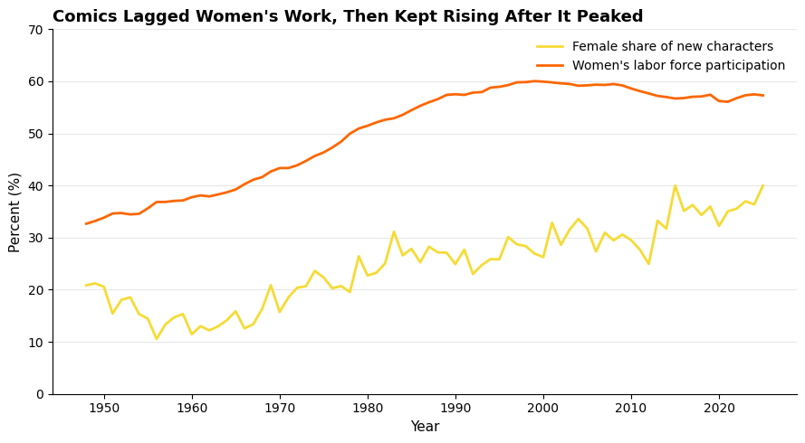
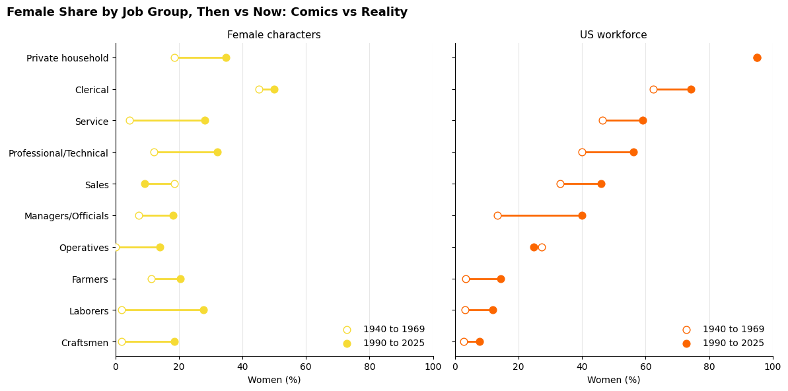

# Comics vs. the American Workforce

**Do Marvel and DC characters reflect the women who entered US paid work? We joined 49,922 comic characters to census and labor data from 1940 to 2025 to find out.**



Comics follow women's move into the workforce, but years behind and with a very different casting. The headline correlation is the weaker finding. The stronger one is about *which jobs* female characters are given.

---

## Questions and answers

| Question | Short answer |
|---|---|
| How male are the two rosters? | About 70% male at both publishers. Marvel is 23.6% female and DC 27.9%. |
| Are comics keeping up with society? | Broadly yes (r = 0.83), but the female share of new characters fell until 1960 while real participation was already rising. |
| How far behind are they? | Best fit is a 7 year lag (r = 0.89). The curve is flat, so this is a trend effect, not a measured reaction time. |
| Do Marvel and DC differ? | Marvel peaks at 7 years, DC at 5. The 2 year gap is inside the noise. |
| What jobs do female characters get? | Jobs that are 50.1% female in reality, against 42.9% for male characters. True in every decade. |
| When did women reach "male" jobs? | Real women passed 20% of historically male jobs in the 1980s. Female characters did in the 2010s. |
| Where did comics miss the most? | Management. Real women gained 26.5 points, comics gained 10.7. In sales, comics went the other way. |
| Do women get working lives? | 57.1% of female characters have a job listed vs. 66.7% of male characters. The gap closed in the 2020s only because new male characters lost their jobs. |

Full answers, hypotheses and caveats for all 16 questions are in the notebook.



---

## What we would tell an editorial team

1. **Benchmark new characters against today's workforce each year,** instead of drifting along years behind it.
2. **Cast women in managerial, professional and other historically male roles,** where comics trail reality by decades.
3. **Give every new character a civilian occupation,** so characters of any gender read as people with working lives.

---

## Method in brief

- **Scraped** every character page from the Marvel (Earth 616) and DC Fandom wikis through their APIs.
- **Cleaned** gender (83 raw values reduced to 4) and about 15,000 free text occupations (mapped to census job groups) with regular expressions.
- **De-duplicated** DC's reboots: 1,953 repeat pages removed, which also removed a fake wave of new characters in the 2010s.
- **Joined** comics to IPUMS job data on job group and decade, and to FRED on year.
- **Tested** lagged correlations, then moved to benchmark comparisons because correlation between two rising lines is weak evidence.

### Limits we state up front

- Only 10,832 male and female characters hold a census type job, so job comparisons cover about a fifth of the roster.
- Eleven census job groups are broad. "Professional/Technical" holds both nurses and physicists.
- Characters are counted by first appearance, not by how often readers saw them.
- Wiki data is volunteer written, and the 2020s are an unfinished decade.

---

## Repository map

```
.
├── README.md
├── notebooks/
│   └── Do-Comics-Mirror-America.ipynb   full analysis, runs top to bottom
├── figures/                             every chart from the notebook as a PNG
├── data/
│   └── README.md                        where the four source files come from
├── requirements.txt
└── .gitignore
```

## Run it yourself

1. Install the packages: `pip install -r requirements.txt`
2. Put the four source CSVs in `data/` (see [data/README.md](data/README.md) for names and sources).
3. Open the notebook and run all cells. In Google Colab it looks for the team Drive folder first, locally it reads from `data/`.

The IPUMS file cannot be redistributed under the IPUMS terms, so none of the raw data is stored in this repository.

---

## Data

| Source | Gives us | Coverage |
|---|---|
| [Marvel Database](https://marvel.fandom.com/wiki/Category:Earth-616/Characters) | Gender, debut year, occupation | scraped 29 Sep 2026, CC BY-SA 3.0 |
| [DC Database](https://dc.fandom.com/wiki/DC_Comics_Database) | Same fields | scraped 29 Sep 2026, CC BY-SA 3.0 |
| [IPUMS USA](https://usa.ipums.org/usa/) | Women's share of each job group | census 1940 to 2000, ACS 2001 to 2023 |
| [BLS via FRED (LNS11300002)](https://fred.stlouisfed.org/series/LNS11300002) | Women's labor force participation | 1948 to 2026 |

---

## Team

Group A07: Daniel Igbokwe, Carly Barry, Eliza Bashirian, Albert Dorofeev (project manager), Emanuele Borroni.

Built for BA780 Introduction to Data Analytics, Questrom School of Business, Boston University, Fall 2026.

### My part (Albert Dorofeev)

I managed the project and, in the final notebook, built the charts for the debut decades (Q2), the female share of new characters (Q4), the lag by publisher (Q8), the job comparison between female and male characters (Q10) and the biggest job shifts (Q14). I also merged the Marvel and DC cleaning code into one shared function, restructured the notebook into themed sections and aligned the chart design.

## AI disclosure

Generative AI tools were used for tutoring, code review and editing, documented per team member in the notebook's disclosure section. The team ran every cell on its own data and checked the figures in the text against the notebook output.
